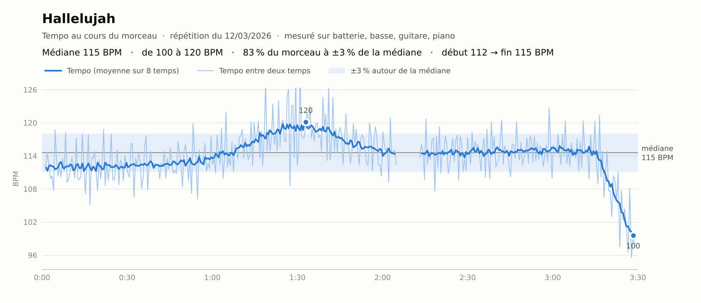

# Musique

Traitement d'enregistrements de répétition (2 chanteuses, piano, batterie acoustique, basse, guitare) :

1. **Découpe** : si un fichier `<nom>.csv` accompagne `<nom>.mp3` (ou `.wav`, `.flac`…), l'audio est découpé en morceaux enregistrés en `.wav`. Sans CSV, l'enregistrement est traité en entier : ce qui précède et suit la chanson (discussions, accordage, silences) est retiré, et le titre est reconnu d'après les paroles (voir plus bas).
2. **Séparation** des instruments avec [Demucs](https://github.com/facebookresearch/demucs) (modèle `htdemucs_6s`) : `voix`, `piano`, `batterie`, `basse`, `guitare`, `autre`. Les pistes sont **conservées sur disque** : une relance ne refait la séparation que pour les morceaux qui ont changé.
3. **Atténuation de l'écho** de la salle sur chaque piste séparée (voir plus bas). Le résultat est aussi gardé sur disque.
4. **Équilibrage** : la sonie (LUFS, norme ITU-R BS.1770) de chaque piste est mesurée, puis les pistes sont ramenées au même niveau.
5. **Volumes personnalisés** : un facteur par instrument, lu dans un fichier JSON, est appliqué.
6. **Chorus léger sur les voix et la basse**, pour épaissir et élargir un peu le son. Sur la basse, seules les fréquences au-dessus de 250 Hz reçoivent le chorus : les graves restent nets et centrés.
7. **Mixage** de toutes les pistes, normalisé à -14 LUFS (crête max. -1 dBFS), puis export en **MP3** nommé `AAAAMMJJ-titre.mp3`.
8. **Analyse du tempo** : un graphique `AAAAMMJJ-titre.jpg` montre les variations de BPM au cours du morceau (voir plus bas).

> Les deux chanteuses sont dans la même piste `voix` : Demucs sépare les instruments, pas les voix entre elles.

## Installation

Il faut [uv](https://docs.astral.sh/uv/). `ffmpeg` est seulement nécessaire pour les formats que libsndfile ne lit pas (`.m4a`, `.aac`, `.wma`).

```bash
uv sync
```

Au premier lancement, Demucs télécharge les poids du modèle (~ 50 Mo) depuis `dl.fbaipublicfiles.com`, et Whisper (reconnaissance des paroles) son modèle `small` (~ 500 Mo) depuis `huggingface.co`.

## Utilisation

```bash
uv run musique-repet <dossier_entree> <dossier_sortie> -c config.json
```

Générer un fichier de configuration d'exemple :

```bash
uv run musique-repet --generer-config config.json
```

### Fichier CSV de découpe

Même nom que l'audio (`repet_12_mars.mp3` → `repet_12_mars.csv`), une ligne par morceau, `titre;debut;fin` :

```csv
titre;debut;fin
Hallelujah;0:45;5:12
Le Sud;6:30;10:02.5
Hallelujah;1:02:10;1:06:40
```

- Temps acceptés : `83`, `83.5`, `1:23`, `1:23.5`, `1:02:03`.
- La ligne d'en-tête est facultative ; les lignes vides ou commençant par `#` sont ignorées.
- Un titre en double devient `Titre (2)`.

### Enregistrement sans CSV : chanson repérée et titre reconnu

Quand un audio n'a pas de CSV, on suppose qu'il contient **une chanson** :

**1. Ce qui précède et suit la chanson est retiré**, d'après les pistes séparées :

- la chanson commence et finit là où le groupe joue ensemble (par exemple 3 sources sur 5 : batterie, basse, guitare, piano, voix) ;
- un instrument seul collé à la chanson est gardé (intro au piano, résonance du dernier accord), sur 30 s au plus ;
- une discussion (voix seule), un accordage ou un échauffement séparés de la chanson par un silence sont retirés ;
- un court fondu adoucit le début et la fin ; les pauses à l'intérieur de la chanson (break) sont gardées.

`--sans-rognage` garde l'enregistrement entier.

> Limite : une introduction *a cappella* (voix seules, sans instrument) ressemble à une discussion et serait coupée. Dans ce cas, utilise un CSV ou `--sans-rognage`.

**2. Le titre est reconnu** pour nommer le MP3 (`20260312-Hallelujah.mp3` au lieu de `20260312-repet_mardi.mp3`). Les paroles de la piste voix sont transcrites en local avec [Whisper](https://github.com/SYSTRAN/faster-whisper), puis :

1. **avec un répertoire** (recommandé) : le titre du répertoire chanté pendant la chanson, ou annoncé dans la minute qui précède (« allez, on fait Le Sud »), est retenu ;
2. **sans répertoire** : la phrase qui revient le plus dans le refrain est proposée comme titre (« Hallelujah », « Let it be », « On dirait le Sud »...) ;
3. sinon le nom du fichier est gardé.

Le répertoire est un fichier `repertoire.txt` placé dans le dossier d'entrée (ou indiqué avec `--repertoire`), une chanson par ligne. Des extraits de paroles facultatifs, séparés par `;`, aident à reconnaître une chanson dont le titre n'est pas chanté :

```text
# Répertoire du groupe
Hallelujah
Le Sud ; on dirait le sud ; le temps dure longtemps
Bohemian Rhapsody ; is this the real life ; is this just fantasy
```

La transcription prend environ une minute par chanson sur processeur ; elle est gardée dans `_travail` et n'est pas refaite à la relance. `--modele-paroles medium` (ou `large-v3`) reconnaît mieux le chant, plus lentement ; `--sans-titre` désactive la reconnaissance.

### Fichier de configuration des volumes

```json
{
  "voix": 1.0,
  "piano": 1.0,
  "batterie": 0.8,
  "basse": 1.0,
  "guitare": 1.0,
  "autre": 0.5
}
```

Facteurs **linéaires**, appliqués après l'équilibrage : `1.0` = inchangé, `0.5` ≈ -6 dB, `2.0` ≈ +6 dB, `0` = piste coupée (pratique pour travailler sa partie). Un instrument absent du fichier reste à `1.0`. Noms anglais acceptés aussi (`vocals`, `drums`, `bass`, `guitar`, `other`).

### Organisation des fichiers produits

Chaque MP3 est nommé `AAAAMMJJ-titre.mp3` :

- `AAAAMMJJ` est la **date de création du fichier audio d'origine** ;
- `titre` est le titre du morceau dans le CSV ; sans CSV, le titre reconnu d'après les paroles, ou à défaut le nom du fichier audio.

```
sortie/
├── 20260312-Hallelujah.mp3   # repet_12_mars.mp3 + CSV : un MP3 par morceau
├── 20260312-Hallelujah.jpg   # … et le graphique de son tempo
├── 20260312-Le Sud.mp3
├── 20260312-Le Sud.jpg
├── 20260315-Let it be.mp3    # repet_15_mars.wav sans CSV : la chanson seule, titre reconnu
├── 20260315-Let it be.jpg
└── _travail/                 # fichiers intermédiaires (réutilisés à la relance)
    ├── decoupes/             # morceaux découpés en .wav
    └── pistes/               # pistes séparées, une par instrument
        └── …/sans_echo/      # les mêmes après atténuation de l'écho
```

Si deux extraits donnent le même nom (même morceau joué deux fois le même jour), le suivant devient `20260312-Hallelujah (2).mp3`.

> La date de création est fournie par macOS et Windows. Sous Linux, elle n'est disponible que sur certains systèmes de fichiers ; sinon la date de dernière modification est utilisée. Attention : copier un fichier remet souvent sa date de création à la date de la copie.

### Atténuation de l'écho

La réverbération d'une grande salle décroît de façon exponentielle. Pour chaque piste, le programme estime à chaque instant et pour chaque fréquence la part de son qui n'est que la traîne des notes précédentes, puis la retire (soustraction spectrale, méthode de Lebart / Habets). Les 50 premières millisecondes après chaque son sont conservées, car elles donnent du corps au son ; seule la traîne est atténuée.

Deux réglages :

- `--rt60` : durée de réverbération de la salle, en secondes (défaut `0.4`). Pour l'estimer, frappe un coup sec (clap, caisse claire) et compte le temps jusqu'à ce que l'écho ne s'entende plus : c'est à peu près le RT60.
- `--anti-echo` : atténuation maximale en dB (défaut `12`, `0` pour désactiver). Au-delà d'environ 15 dB, le son peut devenir « métallique » ou « sous l'eau ».

Changer ces réglages ne refait pas la séparation, seulement l'atténuation (quelques secondes par piste).

### Analyse du tempo

Pour chaque morceau, un graphique JPG du même nom que le MP3 montre comment le tempo a évolué : est-ce que le groupe presse dans les refrains, ralentit dans les passages calmes, finit plus vite qu'il n'a commencé ?



*Exemple obtenu sur une batterie synthétique : le groupe presse jusqu'à 120 BPM vers 1:30, s'arrête pendant un break (courbe interrompue), puis ralentit sur la fin.*

- **Trait épais** : tempo moyen sur 8 temps (deux mesures à 4 temps), la courbe à lire.
- **Trait fin** : tempo mesuré entre chaque temps et le suivant ; ses zigzags montrent la précision rythmique.
- **Bande bleutée** : ±3 % autour du tempo médian. Hors de la bande, l'écart s'entend.
- **En-tête** : tempo médian, plage, part du morceau joué dans la bande, et tempo du début et de la fin.

Le tempo est mesuré sur la batterie, la basse, la guitare et le piano séparés (pas sur les voix, souvent plus libres), après atténuation de l'écho. Les passages sans pulsation régulière (silence, break, intro jouée librement) ne sont pas tracés plutôt que d'afficher un tempo inventé.

Si une ballade est mesurée au double de son vrai tempo (par exemple 144 au lieu de 72, à cause d'un charleston en croches), baisse le tempo maximal recherché : `--bpm-max 120`. À l'inverse, pour un morceau très rapide lu à moitié, monte `--bpm-min`.

### Options utiles

| Option | Rôle |
| --- | --- |
| `--travail DIR` | dossier des fichiers intermédiaires (défaut : `<sortie>/_travail`) |
| `--appareil cuda` | séparation sur GPU (beaucoup plus rapide ; auto-détecté par défaut) |
| `--shifts 2` | séparation plus propre mais plus lente |
| `--forcer-separation` | ignore le cache et refait la séparation |
| `--lufs-cible -16` | sonie du MP3 final |
| `--anti-echo 12` | atténuation max. de l'écho de la salle en dB (`0` = désactivé) |
| `--rt60 0.4` | durée de réverbération de la salle en secondes |
| `--chorus 0.3` | dosage du chorus sur les voix (`0` = désactivé, `0.5` = plus marqué) |
| `--chorus-basse 0.4` | dosage du chorus sur la basse, au-dessus de 250 Hz (`0` = désactivé) |
| `--sans-rognage` | sans CSV : garde tout l'enregistrement |
| `--sans-titre` | sans CSV : garde le nom du fichier au lieu de reconnaître le titre |
| `--repertoire FICHIER` | liste des titres du groupe (défaut : `repertoire.txt` du dossier d'entrée) |
| `--modele-paroles medium` | modèle Whisper pour les paroles : `tiny`, `base`, `small` (défaut), `medium`, `large-v3` |
| `--sans-tempo` | ne produit pas le graphique du tempo |
| `--bpm-min 50` / `--bpm-max 200` | plage de tempos recherchée par l'analyse |
| `--debit 256` | débit MP3 en kb/s |
| `--gain-max-db 12` | correction maximale de l'équilibrage, pour ne pas trop amplifier un instrument qui joue peu |
| `--exclure-equilibrage autre` | pistes laissées à leur niveau d'origine par l'équilibrage (défaut : `autre`, qui contient surtout des résidus de séparation) |

Une piste quasi muette (moins de -50 LUFS, instrument absent du morceau) n'est jamais amplifiée par l'équilibrage.

## Tests

```bash
uv run pytest
```

Les tests utilisent un faux séparateur : ils ne téléchargent pas le modèle.
